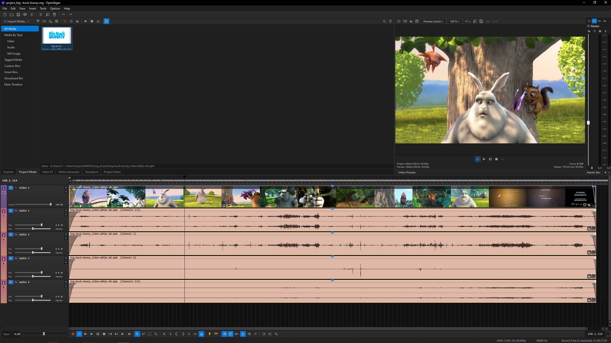

<h1 align="center">OpenVegas</h1>

<p align="center">
  <a href="README.md">English</a> |
  <a href="README.ru.md">Русский</a>
</p>

[](https://github.com/ili4yov-ika/OpenVegas/actions/workflows/ci.yml)



An open, cross-platform video editor — an analogue of **VEGAS Pro 22** written in **C++ / Qt 6.8** under the **GNU GPL**.

The goal is the familiar Vegas workspace (timeline, events, fades/crossfades, media bin, Trimmer, Properties, Event FX, Media Generators, Transitions) and opening `.veg` projects.

Current state: **a working MVP** — A/V playback, compositor, Builtin/VST/OFX (the OFX host loads and renders real `.ofx` files; video plug-ins from Vegas Pro do not work yet — see below), Render As, interchange, `.veg` import (v1 + Event FX + Titles & Text + transitions), timeline editing, and saving projects in a native format.

---

## Screenshot


---

## What works

| Area | Status |
|------|--------|
| UI shell / timeline / media bin | Done |
| Open `.veg` (timings, fades, media pool) | Done (v1) |
| Video Event FX from `.veg` (Glint, Chroma Blur, …) | Done (best-effort) |
| Video preview / compositor (Pan/Crop, Color, FX chain) | Done MVP |
| Audio engine + mixer + Builtin DSP (Delay/Reverb, …) | Done |
| VST1 / VST2 process + editor | Done |
| VST3 process + `IPlugView` editor | Done (requires the SDK) |
| Sound Forge / VEGAS Shared audio plug-ins — hosting + native window | Done (Windows)⁴ |
| OFX host — loading and rendering real `.ofx` (including VEGAS bundles) | Done (host) |
| **Video plug-ins from Vegas Pro — do NOT work yet**³ | Not working |
| Cross-platform OFX — standard roots (`OFX_PLUGIN_PATH`, `/usr/OFX/Plugins`, `/Library/OFX/Plugins`) + ABI gate | Done |
| Event FX UI (Video / Audio, modeless) | Done |
| Video FX — drag and drop of an effect/preset onto a video clip | Partial: dragging from the pane works, dropping on the timeline is not implemented |
| Render As (FFmpeg) + progress UI | Done |
| NLE interchange (Vegas CSV / FCP7 / FCPX / Premiere scrape) | Done MVP¹ |
| Media Generator — VEGAS Titles & Text (animations, hover preview, drag and drop) | Done MVP |
| Titles & Text — editor window, Media Properties, parameter keyframes | Done MVP |
| Transitions — 3D Blinds (4 presets, DnD onto a fade/crossfade, properties window) | Done for 1 group² |
| Transitions from `.veg` (3D Blinds: preset + parameters + binding to the event) | Done |
| Timeline editing: multi-select (Shift/Ctrl), group drag, Split (`S`), Automatic Crossfades, magnet snap | Done |
| Save / Save As — native **OpenVegas Project Archive** | Done |

¹ **No** interchange format carries transitions — that is a limit of the formats themselves, not our defect: Vegas's own exports degrade 3D Blinds to `Cross Dissolve`. What survives in each format is tabulated in [`MARKDOWN/ISSUES_AND_PLANS.md`](MARKDOWN/ISSUES_AND_PLANS.md) (section «Render As / interchange»).
² The other ~24 catalog groups (3D Cascade, Barn Door, Iris, …) are deliberately non-functional placeholders: their tiles cannot be dragged, so you cannot place a transition that does nothing.
³ **Video plug-ins from Vegas Pro currently neither open nor render.** The Event FX chain from a `.veg` is restored and the plug-ins appear in the catalog and in the Event FX window, but they produce no picture. The host itself is sound — a real `Vfx1.ofx` passes `Load → Describe → DescribeInContext → CreateInstance → Render` with status 0; what does not work is **carrying values over from the project**: the OFX parameter blob in a `.veg` is not decoded, the slot arrives empty, and the plug-in honestly renders with a radius of `0`.

⁴ Sound Forge / VEGAS Shared effects (Reverb, Chorus, Track EQ, Wave Hammer Surround, …) turned out to be ordinary **DirectShow transform filters**, so they are hosted through documented interfaces, without reverse engineering. Audio runs as 32-bit float, and the parameter window is the native one, embedded in the Event FX dialog. Windows only: these are in-process COM servers; on other systems builtin substitutes remain. Settings made in the native window are saved with the project and restored on open. Parameters are edited **only** in that window — there is no per-parameter automation and no reading of settings from `.veg`. Analysis: [`MARKDOWN/VEGAS_SHARED_PLUGINS_REVERSE_FULL.md`](MARKDOWN/VEGAS_SHARED_PLUGINS_REVERSE_FULL.md) §6б.

Our own stand-ins (a box blur for Chroma Blur, a sepia matrix for Sepia, a gain on any failed render) are **deliberately disabled** — `OPENVEGAS_EMULATED_VIDEO_FX = 0` in [`src/plugins/OfxHost.h`](src/plugins/OfxHost.h). They used to give the impression that the app was running VEGAS effects when it was running approximations of them. Now an effect that cannot be rendered for real is not rendered at all. **Do not write new implementations of this kind** — there is one way forward: decoding the real parameters. Measurements and plan — [`MARKDOWN/PLAN_OFX_VIDEO_PLUGINS.md`](MARKDOWN/PLAN_OFX_VIDEO_PLUGINS.md).

Details and backlog: [`MARKDOWN/ISSUES_AND_PLANS.md`](MARKDOWN/ISSUES_AND_PLANS.md), [`MARKDOWN/PLAN_VIDEOAUDIOSTACK.md`](MARKDOWN/PLAN_VIDEOAUDIOSTACK.md), [`MARKDOWN/PLAN_VIDEO-AUDIO-PLUGINS-STACK.md`](MARKDOWN/PLAN_VIDEO-AUDIO-PLUGINS-STACK.md).

---

## Stack

| Layer | Choice |
|-------|--------|
| Language / UI | C++17+, Qt 6.8 (Widgets), `.ui` files in `ui/` |
| Build | CMake 3.16+ (preferred) and `OpenVegas.pro` |
| Compilers | MSVC 2022, GCC 9+, Clang 12+ |
| Audio | miniaudio graph, Builtin DSP, VST1–3 |
| Video | software compositor + FFmpeg decode/encode |
| Plug-ins | VST3 SDK (optional), OpenFX host MVP |
| License | GNU GPL v3 or later ([LICENSE](LICENSE)) |

---

## Building and running

Requires **Qt 6.8+** (Widgets + Svg). On Windows, close `OpenVegas.exe` before rebuilding if linking fails because the file is in use.

### Qt Creator (qmake)

Open [`OpenVegas.pro`](OpenVegas.pro), choose a **Qt 6.8+ Widgets** kit (MSVC / MinGW / Clang) → Build.

### CMake

```bash
# Windows MinGW (see also cmake --preset windows-mingw-debug)
cmake -S . -B build/Windows_MinGW-x64 -DCMAKE_PREFIX_PATH=<path-to-Qt6.8>
cmake --build build/Windows_MinGW-x64
```

Running:

```text
build\Windows_MinGW-x64\OpenVegas.exe
build\Windows_MinGW-x64\OpenVegas.exe SAMPLES\veg_projects\project_big--buck-bunny.veg
```

Reference projects to check against:

| What to look at | File in `SAMPLES/veg_projects/` |
| --------------- | ------------------------------- |
| Video Event FX | `project_big--buck-bunny_4x3-preview-reverse-fades-fx.veg` |
| 3D Blinds transitions on fades and crossfades | `project_transitions_3d-blinds.veg` |
| Titles & Text | `project_titles-and-text.veg` |

Optionally copy Vegas subtrees into the **ignored** `build/.../vegas-runtime/`:

```bash
cmake -S . -B build/Windows_MinGW-x64 -DCMAKE_PREFIX_PATH=<Qt6.8> -DOPENVGAS_COPY_VEGAS_RUNTIME=ON
```

**Do not commit** `build/`, `vegas-runtime/` or Vegas binaries — they are in [`.gitignore`](.gitignore).

### VST3 SDK (optional)

A real VST3 host needs the [Steinberg VST3 SDK](https://github.com/steinbergmedia/vst3sdk) (Steinberg's license, separate from the GPL; see its Usage Guidelines).

Shallow-clone it into `thirdparty/vst3sdk` (submodules `pluginterfaces`, `base`, `public.sdk`). CMake sets `OPENVGAS_VST3_SDK_PATH` when the headers are in place; otherwise a pass-through stub is built:

```bash
cd thirdparty/vst3sdk && git submodule update --init pluginterfaces base public.sdk
cmake -S . -B build/Windows_MinGW-x64 -DCMAKE_PREFIX_PATH=<Qt6.8>
```

### OFX video plug-ins

They are searched for in the VEGAS Pro install paths and in the standard OpenFX roots:

| Platform | Roots |
|----------|-------|
| All | `OFX_PLUGIN_PATH` (`;` on Windows, `:` elsewhere) |
| Windows | `%CommonProgramFiles%\OFX\Plugins` |
| macOS | `/Library/OFX/Plugins`, `~/Library/OFX/Plugins` |
| Linux | `/usr/OFX/Plugins`, `/usr/local/OFX/Plugins`, `~/OFX/Plugins` |

VEGAS bundles contain only `Contents/Win64`, so on Linux and macOS they show up in the
catalog but do not load. Our own stand-ins are disabled, so such an effect simply does not
render. Third-party OFX plug-ins built for your OS work fully.

If a plug-in does not load:

```bash
OPENVEGAS_OFX_TRACE=/tmp/ofx.log ./OpenVegas   # log every host callback
OPENVEGAS_OFX_THREADS=1 ./OpenVegas            # single-threaded OFX rendering
```

Details — [`MARKDOWN/PLAN_OFX_VIDEO_PLUGINS.md`](MARKDOWN/PLAN_OFX_VIDEO_PLUGINS.md).

### Tests

```bash
cmake --build build/Windows_MinGW-x64 --target openvegas_audio_tests openvegas_video_tests openvegas_media_tests
ctest --test-dir build/Windows_MinGW-x64 --output-on-failure
```

### CI (GitHub Actions)

On every push / PR to `main`, the workflow [`.github/workflows/ci.yml`](.github/workflows/ci.yml) builds Release on **Ubuntu 22.04**, **Windows 2022** and **macOS 14** (Qt **6.8.3**) and runs `ctest`.

---

## Repository layout

```
OpenVegas/
├── CMakeLists.txt / OpenVegas.pro / CMakePresets.json
├── src/
│   ├── app/ ui/ timeline/ model/ io/
│   ├── audio/ video/ media/ plugins/
├── ui/                   # Qt Designer .ui
├── resources/            # QSS, icons
├── tests/                # Catch2
├── tools/                # installers, utilities
├── MARKDOWN/             # INIT, ISSUES, CHECKLIST, PLAN_*, VEG_READER, UI_STUBS_AUDIT
├── docs/                 # short guides
├── thirdparty/           # vst3sdk / openfx (local, as needed)
└── SAMPLES/              # veg_projects, veg_analyzators, screenshots, Vegas runtime
```

| Path | Purpose |
|------|---------|
| [`src/`](src/) | MainWindow, timeline, model, VegReader, audio/video/media/plugins |
| [`tests/`](tests/) | Catch2: audio / video / media / plugin state |
| [`tools/`](tools/README.md) | NSIS/deb/rpm, macOS/WSL, `svg_to_ico` |
| [`MARKDOWN/`](MARKDOWN/INIT.MD) | Rules, plans, ISSUES, checklist, stub audit |
| [`SAMPLES/`](SAMPLES/README.md) | Reference `.veg` files, media, Vegas Pro 22 |

---

## Vegas references

1. Projects and media — [`SAMPLES/veg_projects/README.md`](SAMPLES/veg_projects/README.md)
2. `.veg` analysis and analyzer scripts — [`SAMPLES/veg_analyzators/README.md`](SAMPLES/veg_analyzators/README.md)
3. Vegas Pro 22 runtime — [`SAMPLES/VEGAS-PRO-22-PROGRAM-FILES/README.md`](SAMPLES/VEGAS-PRO-22-PROGRAM-FILES/README.md)

---

## Documentation

The documents below are written in Russian.

1. **Development rules** — [`MARKDOWN/INIT.MD`](MARKDOWN/INIT.MD)
2. **Bugs and plans** — [`MARKDOWN/ISSUES_AND_PLANS.md`](MARKDOWN/ISSUES_AND_PLANS.md)
3. **Video / Audio stack** — [`MARKDOWN/PLAN_VIDEOAUDIOSTACK.md`](MARKDOWN/PLAN_VIDEOAUDIOSTACK.md)
4. **Plugins stack** — [`MARKDOWN/PLAN_VIDEO-AUDIO-PLUGINS-STACK.md`](MARKDOWN/PLAN_VIDEO-AUDIO-PLUGINS-STACK.md)
5. **OFX / Vegas video plug-ins + cross-platform support** — [`MARKDOWN/PLAN_OFX_VIDEO_PLUGINS.md`](MARKDOWN/PLAN_OFX_VIDEO_PLUGINS.md)
6. **Native OFX forms (reversing `OfxHWndInteractSuite`)** — [`MARKDOWN/PLAN_OFX_HWND_INTERACT_RE.md`](MARKDOWN/PLAN_OFX_HWND_INTERACT_RE.md)
6. **Opening `.veg` (short)** — [`docs/VEG_OPEN.md`](docs/VEG_OPEN.md)
7. **Opening `.veg` (in depth)** — [`MARKDOWN/VEG_READER_V0.md`](MARKDOWN/VEG_READER_V0.md)
8. **Port to Qt + parser** — [`MARKDOWN/QT68_PORT_AND_VEG_OPEN.md`](MARKDOWN/QT68_PORT_AND_VEG_OPEN.md)
9. **Supported files** — [`docs/support_files.md`](docs/support_files.md)
10. **The `.veg` format** — [`SAMPLES/veg_analyzators/00_format_overview.md`](SAMPLES/veg_analyzators/00_format_overview.md)
10a. **The `.veg` container (riff64, reversed with Ghidra)** — [`MARKDOWN/VEG_CONTAINER_FORMAT.md`](MARKDOWN/VEG_CONTAINER_FORMAT.md)
11. **Native project format** — [`MARKDOWN/PROJECT_ARCHIVE_FORMAT.md`](MARKDOWN/PROJECT_ARCHIVE_FORMAT.md)
12. **`.sfk` / `.sfl` sidecars** — [`MARKDOWN/SFK_SFL_SIDECAR_FILES.md`](MARKDOWN/SFK_SFL_SIDECAR_FILES.md)
13. **What in the UI is still a stub** — [`MARKDOWN/UI_STUBS_AUDIT.md`](MARKDOWN/UI_STUBS_AUDIT.md)
14. **Current task checklist** — [`MARKDOWN/CHECKLIST.md`](MARKDOWN/CHECKLIST.md)
15. **Hardware accelerators (VLD, NVENC/QSV/AMF)** — [`MARKDOWN/HARDWARE_ACCELERATOR.md`](MARKDOWN/HARDWARE_ACCELERATOR.md)

---

## License

OpenVegas code is **GNU GPL v3 or later**. Full text: [`LICENSE`](LICENSE).

VEGAS Pro and the materials in `SAMPLES/VEGAS-PRO-22-PROGRAM-FILES/` belong to MAGIX/VEGAS and are **not** covered by the GPL; they are reference material only. Do not publish runtime copies (`build/vegas-runtime/`) to git. The VST3 SDK is under Steinberg's license, separate from the application's GPL.
